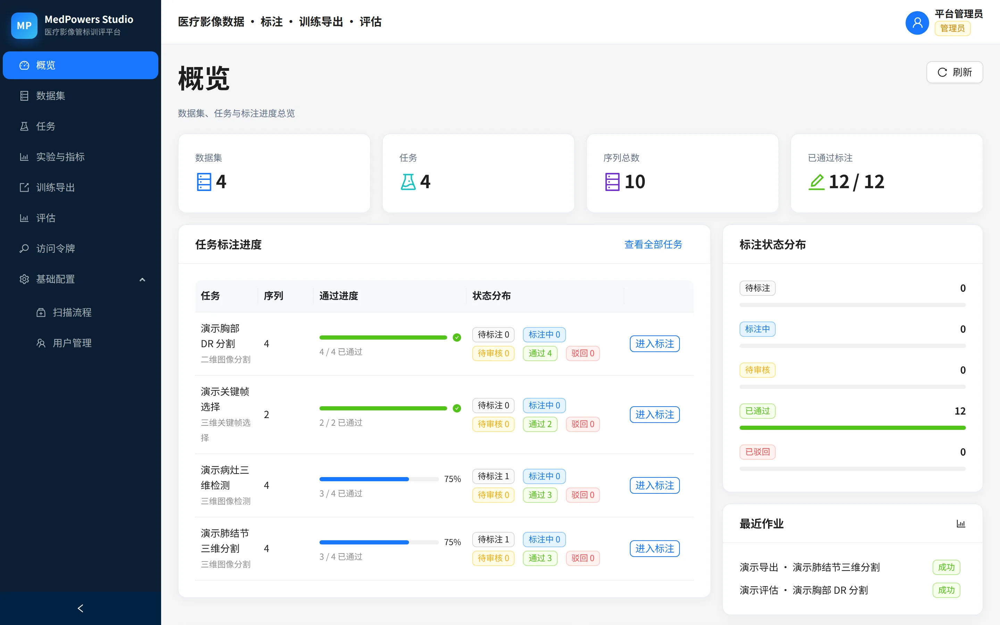
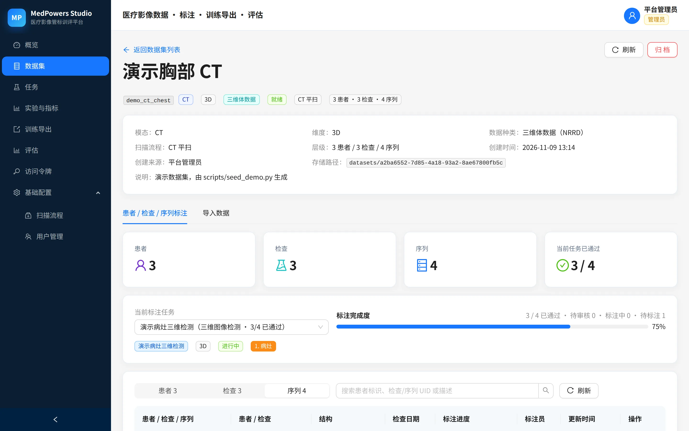
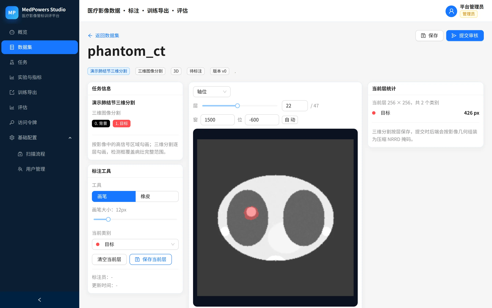
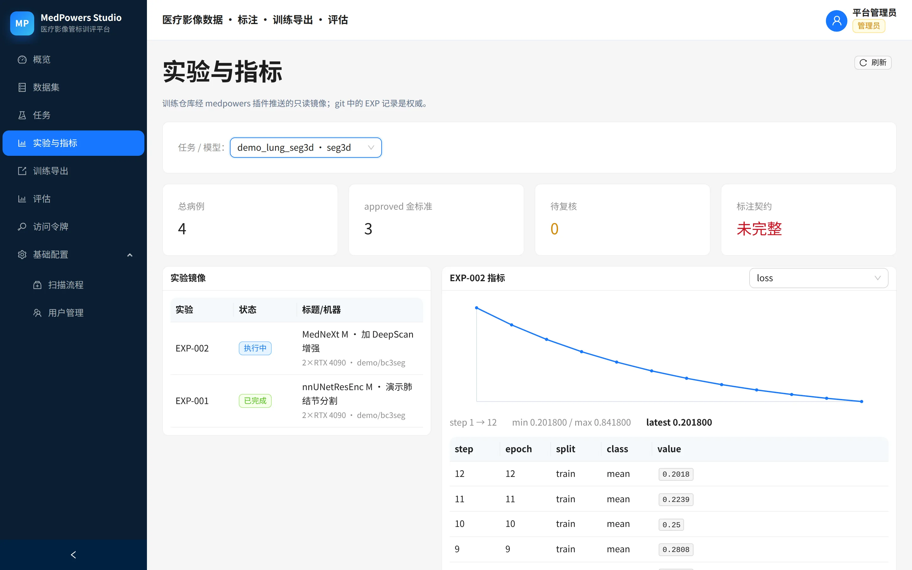
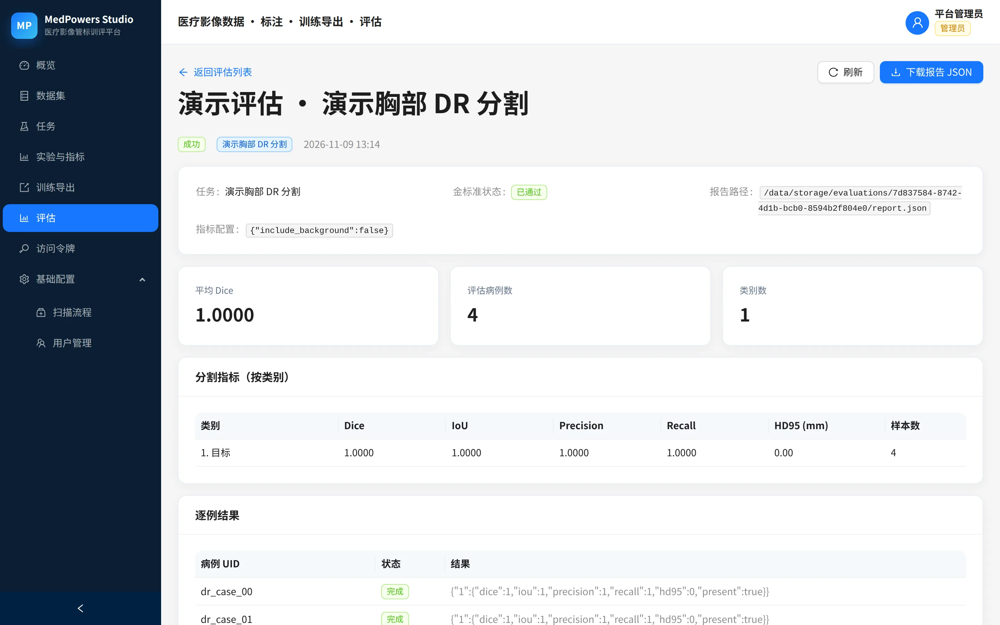
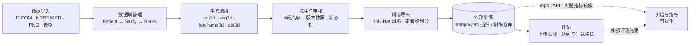
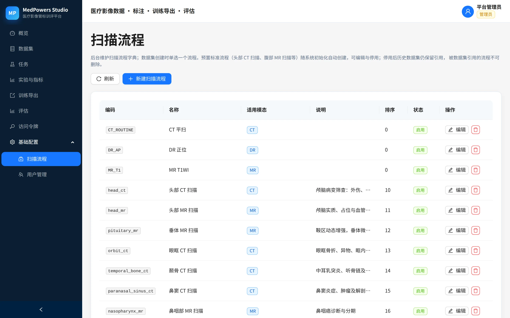
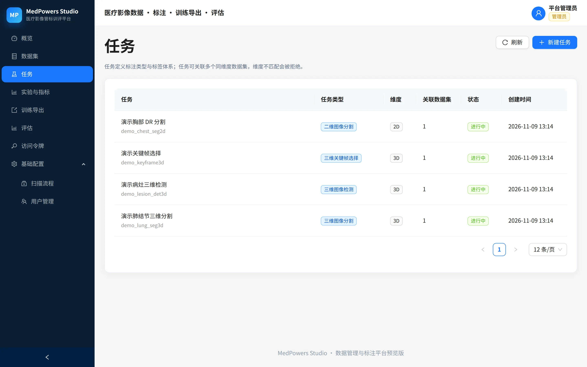

<div align="center">

# MedPowers Studio

**医疗影像数据「管、标、训、评」一体化平台**

把影像数据整理成**训练就绪格式**，并在训练后对预测结果做量化评估——训练本身不在平台内执行：

> **数据集管理 → 任务编排 → 标注与审核 → 训练数据导出 → 模型评估** 的完整数据闭环，
> 与 [medpowers 插件](https://gitlab.suoyin.info/medpowers/medpowers-plugin)（训练方法论技能库）组成「数据底座 + 调优方法论」的联合方案。


[界面速览](#界面速览) · [快速开始](#快速开始) · [配置](#配置) · [数据约定](#数据与格式约定) · [插件接入](#插件与训练仓库接入) · [版本纪律](#版本与发版纪律)

</div>

> **当前状态**：可运行的管理台 + 标注工作台 + 导出/评估闭环，已用合成数据完成端到端验证。下一步等待接入真实数据后细化导入、标注工具与指标。

## 界面速览

**概览**——数据集 / 任务 / 标注进度与状态分布总览：



| 数据集与层级 | 3D 标注工作台 |
|---|---|
|  |  |
| *Patient → Study → Series 层级、扫描流程、标注进度* | *轴位逐层画笔 / 橡皮、窗宽窗位、当前层统计* |

| 实验与指标（插件镜像） | 评估报告 |
|---|---|
|  |  |
| *训练仓库经 medpowers 插件推送的只读镜像与指标曲线* | *按类别 Dice / IoU / HD95 与逐例结果* |

## 总体回路



---

## 已实现能力

### 数据管理

- **扫描流程字典**：系统预置常见标准检查流程（头部 CT 扫描、胸部 CT 扫描、腹部 MR 扫描等，清单见 `backend/app/domain/protocol_presets.py`，启动时按编码幂等补种）；管理员在后台维护编码、名称、适用模态、排序、启停状态，也可自定义新增；数据集创建时只能单选一个流程。

  

- **数据集**：模态支持 `DR`（2D）、`CT`（3D）、`MR`（3D）、`TABLE`（临床表格），维度与数据种类由模态自动推导，可在代码注册表中扩展。
- **数据导入**：
  - 服务器路径导入（复制并规范化到平台内容寻址存储）
  - ZIP 上传导入；大目录可使用后台导入任务
  - 自动识别 DICOM 序列（按 SeriesInstanceUID 分组）、NRRD/NIfTI 体数据、PNG/JPG 二维影像、CSV/XLSX/Parquet/JSON 表格
  - 3D 统一转为压缩 NRRD（z-y-x 轴序），2D 转为 PNG，表格转为 Parquet
  - 从 DICOM / NRRD 头自动建立 **Patient → Study → Series** 层级：`PatientID` 加盐哈希为患者标识，`StudyInstanceUID` / `SeriesInstanceUID` 作为检查与序列标识
  - 原始文件不进入平台长期存储；导入前必须确认已自行备份
- **数据层级**：`Dataset → Patient → Study → Series`。数据集是组织容器，可以覆盖多个患者和检查；一个 `Case` 对应一个序列。缺少患者/检查 UID 时按“检查 UID → 序列级匿名患者”的顺序回退，避免患者级训练划分泄漏。
- 数据集就绪后才能被任务关联；已关联任务的数据集不能归档。

### 任务与标注

| 类型 | 维度 | 标注内容 |
|---|---|---|
| `seg3d` 三维图像分割 | 3D | 逐层体素掩码，提交时组装为压缩 NRRD |
| `seg2d` 二维图像分割 | 2D | 像素掩码 PNG |
| `keyframe3d` 三维关键帧选择 | 3D | 关键切片 z 索引 + 标签 |
| `det3d` 三维图像检测 | 3D | 三维包围框（体素坐标 + RAS mm 世界坐标） |

- 任务与数据集多对多；**严格维度匹配**：2D 任务只能关联 2D DR，3D 任务只能关联 3D CT/MR。

  

- **标注入口在数据集内**：不再提供独立的“标注”菜单。数据集详情支持**患者 / 检查 / 序列**三档视图，默认序列层面（标注与序列强关联）；患者层面可逐级展开，检查层面平铺所有检查，序列层面直接列出所有序列。选择关联任务后可直接看到每条序列的标注状态并进入标注工作台。
- 标注工作台：
  - 3D 轴位逐层画笔/橡皮、类别选择、窗宽窗位、层面滑杆；冠状位/矢状位可查看
  - 2D 整图勾画
  - 关键帧选择与跳转
  - 轴位拖拽画框，右侧调整 z 轴中心/范围，框可编辑/删除
- 标注状态机：`pending → in_progress → submitted → approved / rejected`，驳回可继续修改；管理员可撤回。训练仓库/插件可申请复核：`approved → review_requested`（不改内容/版本，立即移出 approved 金标准池），复核通过回 `approved`，驳回回 `in_progress`。
- 提交时生成标注版本快照（`AnnotationRevision`），导出/评估使用提交版本，保证可复现。
- 三角色登录：管理员、标注员、审核员（JWT + bcrypt）。

### 训练导出

- `nnunet` 风格：
  - 分割：`imagesTr/`、`labelsTr/`、`dataset.json`、`splits.json`、`splits_final.json`、`manifest.json`
  - 关键帧/检测：`images/`、`labels/*.json`、`dataset.json`、`splits.json`、`manifest.json`
- 按 train/val/test 比例 + 随机种子划分，支持患者级分组，避免同一患者跨集合泄漏。
- 只导出所选标注状态（默认仅 `approved`）的病例；manifest 记录数据集、任务、标注版本与文件映射。

### 评估

- 上传预测结果 ZIP，与已审核标注比对，输出逐例与汇总指标。
- 指标：
  - 分割：Dice、IoU、Precision、Recall、HD95（按类别 + 平均）
  - 检测：按类别 TP/FP/FN、Precision/Recall/F1、匹配框平均 IoU
  - 关键帧：按类别 TP/FP/FN、Precision/Recall/F1、平均绝对层误差
- 评估报告以 JSON 保存，页面可直接查看/下载。

### 实验与指标（可视化）

- 「实验与指标」页按任务（= 模型）展示训练仓库推送的实验镜像、指标曲线与外部评测结果；只读，不提供实验正文编辑。
- 任务就绪卡显示 approved / 待复核 / 标注契约完整性；QC 问题直接提示。
- git 中的 `EXP-<NNN>` 记录仍是实验事实权威；Studio 只保存 `(repo_key, exp_id)` 镜像、任意数值指标与评测结果。

### 插件与训练仓库接入

- 面向 [medpowers 插件](https://gitlab.suoyin.info/medpowers/medpowers-plugin)（镜像：[GitHub](https://github.com/LiuuZn/medpowers-plugin)）/训练仓库提供 `mps_` API 访问令牌，按 `studio:read` / `studio:data` / `studio:experiment` / `studio:evaluate` / `studio:review-request` 限制权限；训练仓库 token **不继承用户角色**，不能写标注内容或调用管理端接口。
- 支持 RFC 8628 设备码授权：插件申请设备码（带 `repo_key`）→ 用户在网页批准 → 插件自动领取令牌。
- **实验/指标镜像**：一个 Task 对应一个模型；`/api/studio/experiments` 以 `(repo_key, exp_id)` 幂等 upsert 实验状态，`/metrics:batch` 接收任意数值指标，`/evaluations` 接收外部评测结果。git 中的 EXP 记录是权威，Studio 只做可视化。
- **标注复核**：`/api/annotations/{id}/request-review` 把 `approved` 转为 `review_requested`（不改内容/revision，移出 approved 金标准池），审核通过后恢复。
- 令牌只保存 SHA-256 摘要；停用用户或重置密码会自动撤销其全部令牌；用户管理、令牌管理、设备码审批只允许网页登录会话。
- 接入契约（curl 示例、scope、错误码、限流、插件侧安全要求）：[docs/api-access.md](docs/api-access.md)。

> 默认按内网 HTTP 直连暴露 8000 端口。请使用防火墙限制来源网段；跨不可信网络时必须加 HTTPS 反向代理。

---

## 快速开始

生产部署使用 **Docker Compose（PostgreSQL + 应用）**；本地开发可用守护脚本或热更新模式。前端构建产物由 FastAPI 托管。

### 方式一：Docker Compose（推荐生产/长期运行）

前置：Docker 与 Docker Compose。

```bash
cp .env.example .env        # 修改 MP_DB_PASSWORD、MEDPOWERS_JWT_SECRET、管理员密码
mkdir -p data imports
docker compose up -d --build
docker compose ps
docker compose logs -f
docker compose down         # 停止（数据保留在 ./data）
```

- `db` 服务使用 PostgreSQL 16；`studio` 服务运行 FastAPI + 前端构建产物。
- 数据持久化在 `./data`：`postgres/`（元数据）+ `storage/blobs/sha256/...`（影像/表格/掩码）。
- 大数据导入建议放到 `./imports`，容器内只读挂载为 `/imports`，通过“从服务器路径导入”使用。
- 默认端口 `8000`，可通过 `.env` 的 `MP_PORT` 修改；`MP_DATA_DIR` 可指向 5TB 级专用磁盘。
- **生产环境务必修改** `.env` 中的 `MP_DB_PASSWORD`、`MEDPOWERS_JWT_SECRET` 与 `MEDPOWERS_BOOTSTRAP_ADMIN_PASSWORD`。

### 方式二：本地守护脚本（单机调试）

前置：`uv`、`npm`（仅首次构建前端需要）、`curl`。

```bash
./scripts/start.sh          # 同步依赖、首次构建前端，然后 nohup 后台启动（默认 SQLite）
./scripts/status.sh
./scripts/logs.sh
./scripts/stop.sh
```

- 默认监听 `0.0.0.0:8000`，可通过 `MP_HOST` / `MP_PORT` 覆盖。
- 首次启动或前端构建产物不存在时会自动执行 `npm ci && npm run build`；强制重建使用 `./scripts/start.sh --build`。
- PID 写入 `run/medpowers-studio.pid`，日志写入 `logs/medpowers-studio.log`。
- 配置：`cp backend/.env.example backend/.env` 后按需修改；不创建 `.env` 时使用默认配置。
- 访问 <http://127.0.0.1:8000>，API 文档 <http://127.0.0.1:8000/docs>。

### 方式三：开发模式（热更新，仅开发时使用）

```bash
# 终端 A：后端热更新
cd backend && uv sync --extra dev
uv run uvicorn app.main:app --reload --port 8000

# 终端 B：前端 Vite
cd frontend && npm install && npm run dev
```

访问 <http://127.0.0.1:5173>，Vite 将 `/api` 代理到 `http://127.0.0.1:8000`。此模式需要保持终端运行，仅用于开发调试。

> 更详细的升级、备份、迁移与常见问题见 [`docs/deployment.md`](docs/deployment.md)。

### 演示数据（可选）

```bash
cd backend
uv run python scripts/seed_demo.py
```

脚本会创建：

- 3 个扫描流程、3 个数据集（CT/MR/DR）、9 个合成病例
- 4 个任务：3D 分割、3D 检测、3D 关键帧、2D 分割
- 标注员/审核员账号
- 一批已审核标注、1 个导出作业、1 个评估作业（平均 Dice 1.0）

演示账号：

| 账号 | 密码 | 角色 |
|---|---|---|
| `admin` | `admin123` | 管理员 |
| `annotator1` | `pass1234` | 标注员 |
| `reviewer1` | `pass1234` | 审核员 |

> 重置演示数据：停止服务，删除 `data/`（容器模式）或 `backend/medpowers_studio.db` + `backend/storage/`（本地模式），重新执行 seed 脚本。

### 导入 spine_locator 真实数据（可选）

`backend/scripts/import_spine_keyframes.py` 把 spine_locator 的 3D NRRD 影像与 T12/T13/L1 关键帧标注导入平台：

```bash
cd backend
uv run python scripts/import_spine_keyframes.py --dry-run --limit 5   # 先检查
uv run python scripts/import_spine_keyframes.py                       # 全量导入
```

- 默认读取 `/ssd/data/spine/images/*.nrrd` 与 `../../spine_locator/nrrd_slice_mapping.json`，可用 `--images-dir`、`--mapping` 覆盖。
- 影像会复制到平台内容寻址 Blob（同一哈希去重），不再以绝对路径引用；默认只导入 mapping 中的有标注病例，`--include-unannotated` 可同时登记其余影像。
- 自动创建 CT/3D 数据集「脊柱关键层面 CT（spine_locator）」与 `keyframe3d` 任务，标签 `T12=1 / T13=2 / L1=3`；导入标注状态为「标注中」，可直接在标注工作台阅片和调整。
- 幂等：数据集/任务按编码复用，病例按 `case_uid` 复用；已有标注默认不覆盖，`--update-annotations` 可按 mapping 重新同步未提交标注。
- 升级已有数据库时，启动会自动补齐 `cases` 层级字段；历史病例再执行 `uv run python scripts/backfill_hierarchy.py`，从 NRRD 头补建 Patient/Study/Series。

---

## 配置

所有后端配置都支持 `MEDPOWERS_` 前缀环境变量，示例见 [`backend/.env.example`](backend/.env.example)。

<details>
<summary><b>展开配置项一览</b></summary>

| 变量 | 默认值 | 说明 |
|---|---|---|
| `MEDPOWERS_DATABASE_URL` | `backend/medpowers_studio.db` | 本地默认 SQLite；Compose 使用 PostgreSQL |
| `MEDPOWERS_STORAGE_ROOT` | `backend/storage` | 内容寻址 Blob、标注、导出、评估产物根目录 |
| `MEDPOWERS_STORAGE_MIN_FREE_GB` | `50` | 导入前要求保留的空闲空间 |
| `MEDPOWERS_JWT_SECRET` | 开发默认值 | 生产环境必须覆盖（≥32 字节） |
| `MEDPOWERS_BOOTSTRAP_ADMIN_USERNAME` | `admin` | 首次启动创建的管理员 |
| `MEDPOWERS_BOOTSTRAP_ADMIN_PASSWORD` | `admin123` | 首次启动创建的管理员密码 |
| `MEDPOWERS_PATIENT_SALT` | `medpowers-studio` | 患者标识哈希盐 |
| `MEDPOWERS_MAX_UPLOAD_MB` | `4096` | ZIP 上传大小上限 |
| `MEDPOWERS_SLICE_CACHE_VOLUMES` | `4` | 进程内 3D 体数据缓存个数 |
| `MEDPOWERS_CORS_ORIGINS` | localhost:5173 | JSON 数组 |
| `MEDPOWERS_ENVIRONMENT` | `development` | `production` 时拒绝默认 JWT secret |
| `MEDPOWERS_PUBLIC_BASE_URL` | 空 | 设备码授权链接的对外地址 |
| `MEDPOWERS_ALLOWED_HOSTS` | `[]` | 可选 Host 白名单（JSON 数组） |
| `MEDPOWERS_ENABLE_HSTS` | `false` | 仅 HTTPS 反向代理后开启 |
| `MEDPOWERS_API_TOKEN_DEFAULT_EXPIRE_DAYS` | `90` | 设备码授权令牌默认有效期 |
| `MEDPOWERS_API_TOKEN_MAX_EXPIRE_DAYS` | `365` | 手动创建令牌最大有效期 |
| `MEDPOWERS_DEVICE_CODE_EXPIRE_SECONDS` | `600` | 设备码有效期 |
| `MEDPOWERS_AUTH_RATE_LIMIT_PER_MINUTE` | `20` | 认证接口限流阈值 |

Compose 额外变量：`MP_DATA_DIR`（数据目录，默认 `./data`）、`MP_IMPORT_DIR`（导入目录，默认 `./imports`）、`MP_DB_NAME/MP_DB_USER/MP_DB_PASSWORD`。

</details>

> **生产环境务必修改默认管理员密码、数据库密码与 JWT secret。** 首次登录后请在「用户管理」中重置密码。

---

## 数据与格式约定

- **数据自包含**：影像/表格/掩码保存在 `storage_root/blobs/sha256/<前2位>/<次2位>/<sha256>`；数据库只存相对 storage key，不再保存宿主机绝对路径。
- **3D**：DICOM Series / NRRD / NIfTI 统一规范化为压缩 NRRD；numpy 轴序固定 `(Z, Y, X)`；世界坐标约定 RAS、物理 mm。
- **2D**：单帧 DICOM / PNG / JPG / BMP / TIFF 统一规范化为无损 PNG。
- **表格**：CSV / TSV / XLSX / Parquet / JSON 统一规范化为 Parquet；XLSX 每个 sheet 一个 Case；表格 MVP 只支持浏览，不参与标注/导出/评估。
- **原始文件不保留**：平台只保留规范化格式；导入时必须确认“已自行备份原始数据”。`source_manifest` Blob 记录原文件名/大小/源格式，但不能还原原始文件。
- **分割掩码**：`uint8`，值 = 类别 id，0 为背景。
- **关键帧**：`{"frames":[{"label_id":1,"z_index":8}]}`，z 为轴位层面索引。
- **3D 检测框**：以体素坐标 `[x,y,z]` 保存，后端根据影像 origin/spacing/direction 换算为世界坐标 AABB；导出与评估同时包含 `center_voxel/size_voxel` 和 `center_world/size_world`。
- **患者级划分**：优先使用 DICOM PatientID 哈希；无患者标识时优先由 StudyInstanceUID 派生患者，再退化为每个序列独立匿名患者，避免同一患者跨 split 泄漏。
- **扫描流程**：影像数据集必选且只能选一个，优先使用预置标准流程；表格数据集使用内置 `table_default` 流程。停用流程不会破坏历史数据集引用；存量数据集可用 `backend/scripts/apply_preset_protocols.py`（默认 dry-run）按部位关键词批量改绑到预置流程。

---

## 目录结构

<details>
<summary><b>展开完整目录树</b></summary>

```text
medpowers-studio/
├── backend/
│   ├── app/
│   │   ├── api/            # 认证、用户、扫描流程、数据集、病例、任务、标注、导出、评估、概览
│   │   ├── domain/         # 模态/数据种类/任务类型注册表、标签校验、常量
│   │   ├── metrics/        # 分割/检测/关键帧指标
│   │   ├── services/       # 导入、资产存储、层级、切片、标注、导出、评估
│   │   │   ├── asset_store.py
│   │   │   ├── formats/    # volume / image / table 适配器
│   │   │   └── import_jobs.py
│   │   ├── config.py       # pydantic-settings
│   │   ├── db.py           # SQLAlchemy engine/session
│   │   ├── models.py       # ORM 模型
│   │   ├── schemas.py      # Pydantic 请求/响应
│   │   └── main.py         # FastAPI 应用与静态前端托管
│   ├── migrations/         # Alembic
│   ├── scripts/            # seed_demo、迁移、校验、GC
│   ├── tests/              # pytest：认证、维度匹配、格式、标注、导出、评估
│   └── pyproject.toml
├── frontend/
│   └── src/
│       ├── api/            # axios 客户端与类型
│       ├── auth/           # 登录态
│       ├── components/     # 状态标签、标签编辑器、2D/3D 标注画布
│       ├── layouts/        # 主布局
│       └── pages/          # 概览、数据集（含标注）、任务、实验与指标、导出、评估、配置、用户
├── scripts/                # start.sh / stop.sh / status.sh / logs.sh
├── Dockerfile              # 多阶段构建：前端 + 后端镜像（非 root）
├── docker-entrypoint.sh    # 权限修正 + Alembic 迁移 + 启动
├── docker-compose.yml      # PostgreSQL + 应用容器
├── docs/design.md          # 需求分析、领域模型、格式约定、开放问题
├── docs/deployment.md      # 启动、升级、备份、迁移与常见问题
├── docs/api-access.md      # mps_ API 接入契约（scope、设备码、限流）
├── docs/images/            # README 截图（webp）
├── run/                    # 运行时 PID（gitignore）
├── logs/                   # 服务日志（gitignore）
├── data/                   # Docker 持久化数据（gitignore）
└── README.md
```

</details>

---

## 测试与构建

```bash
# 后端
cd backend
uv run ruff check app tests scripts
uv run pytest

# 前端
cd frontend
npm run build
```

当前后端测试覆盖：认证与角色、扫描流程作用域、严格维度匹配、DICOM/NRRD/NIfTI/PNG/CSV/XLSX/Parquet 导入、内容去重、表格分页、2D/3D 标注提交审核、关键帧/检测数据、nnU-Net 导出、评估指标、后台导入任务。

---

## 版本与发版纪律

版本号与 **medpowers 插件**（[GitLab](https://gitlab.suoyin.info/medpowers/medpowers-plugin) / [GitHub](https://github.com/LiuuZn/medpowers-plugin)）**同步演进、保持一致**：

- **发版 = 两仓同时升版**：mps 以 `backend/pyproject.toml` 与 `frontend/package.json` 的 `version` 为准，mpp 以 `.claude-plugin/plugin.json` 的 `version` 为准；发版时两仓改为同一个 `vX.Y.Z` 并各自打 tag；
- 日常滚动 main 不动 `version`；README 顶部徽章随发版顺手同步；
- 双远端镜像（GitHub 公开发布）：`medpowers-studio` → <https://github.com/LiuuZn/medpowers-studio>，`medpowers-plugin` → <https://github.com/LiuuZn/medpowers-plugin>；
- **分支纪律（强制，2026-11-09 起）**：原始提交只进私有 GitLab 且必须落在开发分支（`<type>/<topic>`），禁止 `main` 直提；开发分支经 MR 强制 squash 合入 `main`（GitLab 保护分支：push=No one，服务端拒绝直推）；GitHub 发布面只含 `main + tags`，不承载开发分支与中间提交。详见 AGENTS.md「分支与提交纪律」。

---

## 当前边界与下一步

- **3D 分割首版仅支持轴位逐层勾画**；冠状位/矢状位可查看但不能编辑。下一版可加入三视图联动与插值。
- **表格 MVP 只支持导入/浏览**；表格不参与标注、训练导出、评估。
- **大目录导入**可走后台任务（单进程线程池），但还不是分布式队列；超大并发/多副本需引入独立 worker。
- **数据集版本/快照未实现**；导出与评估通过标注版本和 manifest 保证可复现。
- **多标注员盲标、仲裁、任务分配**尚未实现；当前任何标注员都可处理任务下所有病例。
- **训练运行、模型管理、推理服务**不在首版范围；评估目前通过上传预测 ZIP 完成。
- **3D 框世界坐标**在方向矩阵非单位矩阵时按 AABB 处理，斜向扫描的精确有向框留待后续。
- **DICOM 去标识化**目前仅哈希 PatientID；若需对外共享，还需按院方规范处理其他隐私标签。
- **原始文件不保留**：平台只保存规范化格式；需要重新转换 DICOM/NIfTI 时必须依赖用户自己的备份。

更详细的需求分析、领域模型和待确认问题见 [`docs/design.md`](docs/design.md)。

---

<div align="center">

**MEDPOWERS STUDIO** · 医疗影像数据「管、标、训、评」一体化平台 · v0.16.0

数据与证据在平台，判断力在方法论——与 [medpowers 插件](https://gitlab.suoyin.info/medpowers/medpowers-plugin)联合使用

</div>
